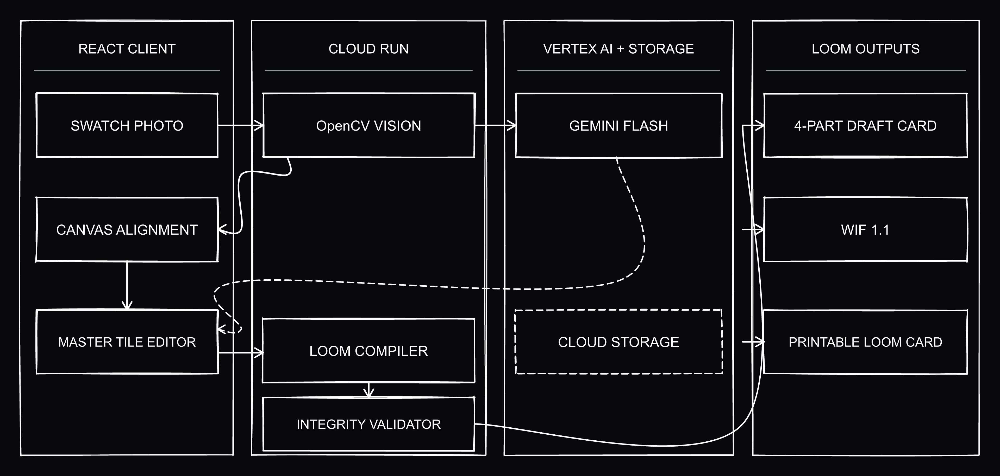

# 🧵 ThreadLore
### AI-Assisted Physical Textile-to-Loom Reconstruction Pipeline
**"Preserve the weave, not just the photograph."**

[](https://cloud.google.com/run)
[](https://cloud.google.com/vertex-ai)
[](https://fastapi.tiangolo.com)
[](https://react.dev)
[](https://opencv.org)
[](https://www.python.org)
[](LICENSE)

> Built for the **Google Cloud Run "Build for Good" Hackathon** · Official Launch: **November 20, 2026** on Product Hunt.

---

## 🌟 Overview: What is ThreadLore?

Traditional handwoven textiles encode ancestral mathematics and cultural heritage. Physical heritage fabrics survive in community archives, museums, and family collections, but their original weaving drafts (loom setup instructions) are frequently lost to history.

Reconstructing weaving drafts manually requires optical magnification, days of tedious graph plotting, and master-level weaving expertise.

**ThreadLore** is an **AI-assisted, human-verified weave reconstruction tool** that converts macro photographs of flat woven fabrics into editable, mathematically validated, loom-compatible **WIF 1.1 (Weaving Information Files)** and visual 4-part loom draft cards (Threading, Tie-Up, Treadling, and Drawdown) ready for physical 4-shaft floor or table looms.

ThreadLore does not attempt ungrounded archaeological discovery or speculative storytelling from a photograph alone:
- **Computer Vision & Gemini Flash:** Estimate thread density, deskew geometry, detect non-textile objects, and suggest candidate weave structures.
- **OpenCV K-Means Clustering:** Automatically extracts dominant warp and weft yarn hex colors directly from cropped fabric swatches.
- **Human Verification Loop:** Users verify or adjust the pattern using an interactive $N \times N$ master tile editor ($N \in \{2, 3, 4\}$) with live canvas overlays and draggable grid alignment.
- **Deterministic Python Compiler:** Closed-form Boolean matrix algebra guarantees that the confirmed structure reproduces the draft under 4-shaft / 4-treadle rising-shed constraints.
- **Authentic Provenance:** Cultural origin, maker, date, and historical notes remain strictly user-supplied metadata.

```
[ Macro Photo ] -> [ OpenCV 2D FFT & K-Means ] -> [ Gemini Flash ] -> [ Master Tile Editor ] -> [ Boolean Compiler ] -> [ WIF 1.1 ]
```

---

## 📐 System Architecture

ThreadLore deploys a stateless **Google Cloud Run** container combining compute-heavy OpenCV pre-processing and Python compilation, orchestrated with **Vertex AI** for zero-shot pattern curation.



*High-resolution vector available at [docs/assets/threadlore_architecture.svg](docs/assets/threadlore_architecture.svg) and editable diagram source at [docs/assets/ThreadLore_Architecture.excalidraw](docs/assets/ThreadLore_Architecture.excalidraw).*

---

## 🔄 System Flow & State Machine

The pipeline enforces mathematical verification at every stage, combining optical deskewing with human-in-the-loop pattern confirmation before calculating loom harness mechanics.


*High-resolution vector available at [docs/assets/threadlore_flow_diagram.svg](docs/assets/threadlore_flow_diagram.svg).*

---

## 💡 Core Features & Engineering Highlights

### 1. The UX Inversion: Master Repeat Tile
- **Problem:** Editing an entire $16 \times 16$ grid (256 cells) cell-by-cell is tedious. A single misclick breaks mathematical symmetry, causing draft compilers to explode from 4 shafts to 16 shafts.
- **Solution:** The user only edits an $N \times N$ Master Tile ($N \in \{2, 3, 4\}$, max 16 cells). The frontend live-tiles this block across the fabric photo. Mathematical symmetry is guaranteed by construction.

### 2. Automatic Dominant Yarn Color Extraction (OpenCV K-Means)
- Analyzes cropped textile pixels in LAB color space via K-Means clustering ($K=2$ dominant clusters with $K=4$ fallback).
- Automatically seeds warp and weft hex color pickers, minimizing manual setup while keeping colors fully editable.

### 3. Non-Textile Guard & Live Crop Resolution Warning
- **Crop Quality Guard:** Live aspect ratio and pixel resolution checks warn users if a crop is under $128 \times 128$ px before processing.
- **Non-Textile Guard:** Detects non-textile surfaces (wood, paper, basketry) and safely disables draft compilation with clear guidance to upload a woven swatch.

### 4. Frequency-Domain Geometry (OpenCV 2D FFT)
- 2D Fast Fourier Transform extracts independent horizontal spacing ($\Delta x$) and vertical spacing ($\Delta y$), supporting fabrics where Ends Per Inch (EPI) != Picks Per Inch (PPI).
- Principal spectral orientation calculates skew angle ($\theta$) for automatic affine rotation deskewing.
- Interactive canvas provides draggable $X/Y$ grid origin offsets for precise yarn alignment.

### 5. Grounded AI Technical Curation (Vertex AI Gemini 3.8 Flash)
- Recommends from 11 canonical weave structures: Plain (1/1) and all 5 straight-twill ratios in S and Z directions (1/2, 2/1, 1/3, 2/2, 3/1).
- Strictly confined to technical float analysis; cultural history and provenance are never hallucinated.
- Gracefully falls back to manual selection if confidence is below 60%.

### 6. Deterministic Boolean Matrix Factorization
- Factors the confirmed $N \times N$ drawdown matrix $D$:
  - Unique columns map to Loom Shafts ($S \le 4$).
  - Unique rows map to Loom Treadles ($T \le 4$).
  - Tie-up matrix is solved in closed form: $M[s, t] = D[i_t, j_s]$.
- Proves 100% mathematical round-trip equivalence between simulated drawdown and input pattern.

### 7. Universal WIF 1.1 Specification Export
- Generates plain-text `.wif` files adhering to the October 1997 WIF 1.1 specification.
- Enforces 1-based indexing, mandatory `[WEAVING]` sections (`Shafts=4`, `Treadles=4`, `Rising shed=1`), dual-color palettes, and CRLF line terminators.
- Ready for immediate import into WeavePoint, Fiberworks, Handweaving.net, or digital dobby looms.

---

## 📚 Documentation Index

| Document | Purpose |
|---|---|
| 📐 **[Technical Architecture](docs/architecture.md)** | In-depth breakdown of 2D FFT, Gemini curation, and Boolean matrix factorization. |
| 📜 **[WIF 1.1 Specification Guide](docs/wif_spec_guide.md)** | Standard compliance rules, section layout, and parser verification. |
| 🎨 **[Architecture Diagram Source](docs/assets/ThreadLore_Architecture.excalidraw)** | Editable hand-drawn chalkboard architecture blueprint (Excalidraw). |

---

## 🛠️ Technology Stack

| Domain | Technology | Purpose |
|---|---|---|
| **Frontend** | React 18, TypeScript, Tailwind CSS, Vite | Responsive UI, interactive master tile editor, live canvas overlay |
| **Backend** | Python 3.11, FastAPI, Uvicorn | Stateless REST API, async image and compilation pipelines |
| **Computer Vision** | OpenCV Headless, NumPy, SciPy | 2D FFT frequency spectrum, CLAHE contrast, affine deskew, K-Means color clustering |
| **Generative AI** | Google Cloud Vertex AI (Gemini 3.8 Flash) | Weave structure curation, template pre-population, technical explanations |
| **Hosting & Cloud** | Google Cloud Run, Cloud Storage, Cloud Build | Serverless container execution, swatch archiving |
| **Quality & Testing** | Pytest, Ruff, Mypy (strict), ESLint, Vitest | Static analysis, strict typing, automated unit and integration tests |

---

## 🚀 Quickstart & Local Setup

### Prerequisites
- Python 3.11+
- Node.js 20+ and `npm`
- Docker (optional)

### 1. Clone and Install
```bash
git clone https://github.com/KenEverestNunes/ThreadLore.git
cd ThreadLore

# Set up Python virtual environment
python -m venv .venv
source .venv/bin/activate  # On Windows: .venv\Scripts\activate
pip install -r backend/requirements.txt -r backend/requirements-dev.txt

# Install frontend dependencies
npm --prefix frontend install
```

### 2. Environment Configuration
Create a `.env` file in the root directory:
```env
PROJECT_ID=threadlore-dev
LOCATION=us-central1
GEMINI_MODEL=gemini-3.8-flash
GCS_BUCKET_NAME=threadlore-swatches-dev
ALLOW_EXTERNAL_IMAGE_PROCESSING=true
CORS_ORIGINS=["http://localhost:5173", "http://127.0.0.1:5173"]
```

### 3. Run Development Servers
```bash
# Terminal 1: FastAPI Backend
uvicorn backend.app.api.server:app --reload --port 8000

# Terminal 2: Vite Frontend
npm --prefix frontend run dev
```

Open `http://localhost:5173` in your browser.

---

## 🧪 Testing & Verification

ThreadLore enforces automated quality gates:

```bash
# Backend linting and strict type checking
ruff check backend/
ruff format --check backend/
mypy backend/

# Backend unit and integration tests
pytest backend/tests/ -v

# Frontend type checking, linting, and tests
npm --prefix frontend run lint
npm --prefix frontend test
npm --prefix frontend run build
```

---

## 📡 REST API Reference

| Method | Endpoint | Description |
|---|---|---|
| `GET` | `/healthz` | Container health probe. |
| `POST` | `/api/swatch` | Ingests macro swatch photo; returns deskewed image, thread periodicity, dominant colors, and Gemini curation. |
| `POST` | `/api/compile` | Ingests $N \times N$ master tile; returns validated draft, shaft/treadle allocation, and WIF string. |
| `POST` | `/api/download-wif` | Streams downloadable standards-compliant `.wif` attachment. |

---

## ⚖️ Engineering Decisions & Guardrails

- **Why Cap at 4 Shafts?** The vast majority of traditional handweavers and community studios operate 4-shaft table or floor looms. Capping at 4 shafts ensures exported WIF files are immediately usable on common looms.
- **Why Exclude Satin?** True satin requires at least 5 shafts (5-end satin). Supporting satin would exceed the 4-shaft ceiling and produce unweavable drafts on entry-level looms.
- **Why Human-in-the-Loop?** Macro smartphone photos contain yarn fuzz, irregular slubs, and directional shadows that make fully automated pixel crossing detection brittle. Human verification guarantees 100% mathematical accuracy before taking the draft to a physical loom.

---

## 📄 License

Distributed under the **MIT License**. See `LICENSE` for details.
