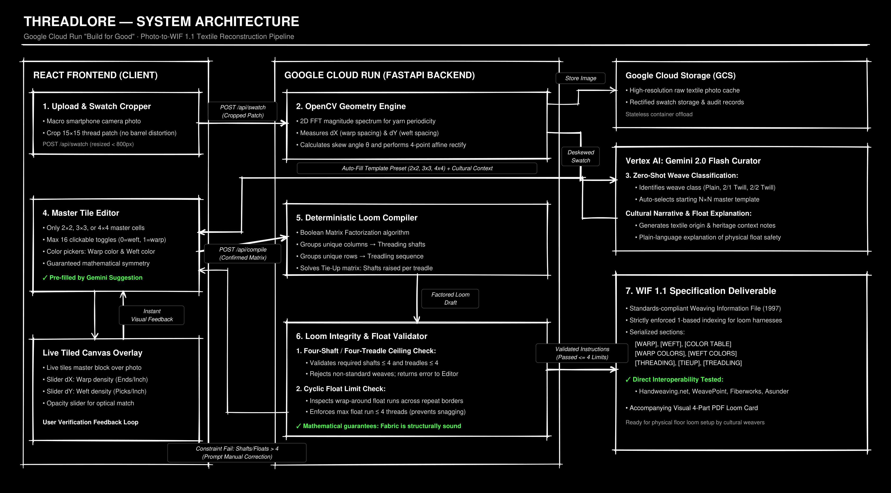
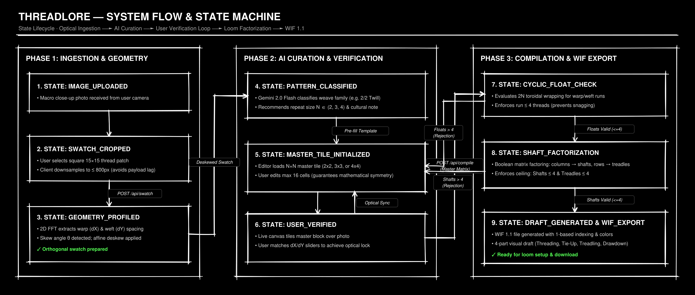

# 🧵 ThreadLore
### AI-Assisted Physical Textile-to-Loom Reconstruction Pipeline

[](https://cloud.google.com/run)
[](https://cloud.google.com/vertex-ai)
[](https://fastapi.tiangolo.com)
[](https://react.dev)
[](https://opencv.org)
[](https://www.python.org)
[](LICENSE)

> Built for the **Google Cloud Run "Build for Good" Hackathon** · Official Launch: **November 20, 2026** on Product Hunt.

---

## 🌟 Overview: What is ThreadLore?

Traditional handwoven textiles encode ancestral knowledge, mathematical precision, and cultural identity. Across the globe, physical heritage fabrics survive in community archives, museums, and family collections—but their original weaving drafts (the loom setup instructions) are frequently lost to history.

Reconstructing weaving drafts manually requires optical magnification, days of tedious graph plotting, and master-level weaving expertise. 

**ThreadLore** transforms a smartphone macro photograph of a woven textile into an editable digital draft and an industry-standard **WIF 1.1 (Weaving Information File)** ready to be loaded onto physical 4-shaft floor looms or weaving software.

```
[ Macro Photo ] ──► [ OpenCV 2D FFT ] ──► [ Gemini 2.0 Flash ] ──► [ Master Tile Editor ] ──► [ Boolean Compiler ] ──► [ WIF 1.1 ]
```

---

## 📐 System Architecture

ThreadLore uses a clean left-to-right architecture that consolidates compute-heavy OpenCV and Python compilation inside a stateless **Google Cloud Run** container, orchestrated with **Vertex AI** for zero-shot pattern curation and **Cloud Storage** for swatch caching.



*High-resolution Excalidraw whiteboard vector available at [`threadlore_architecture.svg`](threadlore_architecture.svg) or via the [Interactive HTML Board](architecture_whiteboard.html).*

---

## 🔄 System Flow & State Machine

The pipeline enforces rigorous mathematical verification at every stage, combining fast optical deskewing with human-in-the-loop pattern confirmation before calculating loom harness mechanics.



*High-resolution vector available at [`threadlore_flow_diagram.svg`](threadlore_flow_diagram.svg).*

---

## 💡 Core Innovations & Engineering Decisions

### 1. The UX Inversion: Master Repeat Tile
- **The Problem:** In classical weaving tools, editing an entire $16 \times 16$ grid (256 cells) cell-by-cell is tedious. A single misclicked pixel breaks mathematical symmetry, causing draft compilers to explode from 4 shafts to 16 shafts.
- **The Solution:** The user **only edits an $N \times N$ Master Tile** ($N \in \{2, 3, 4\}$, max 16 cells). The frontend live-tiles this block across the fabric photo. Mathematical symmetry is guaranteed by construction.

### 2. Grounded AI Curation (Vertex AI)
- **The Problem:** Multimodal LLMs hallucinate when asked to count dense $100 \times 100$ pixel grid crossings from photographs.
- **The Solution:** Gemini 2.0 Flash is used exclusively for **semantic curation**:
  - Classifies the structural weave family (`Plain`, `2/1 Twill`, `2/2 Twill`, `3/1 Twill`).
  - Pre-populates the master tile with the recommended template.
  - Drafts historical provenance notes and explains physical yarn constraints.

### 3. Frequency-Domain Geometry (OpenCV)
- 2D Fast Fourier Transform (FFT) extracts independent horizontal thread spacing ($\Delta x$) and vertical thread spacing ($\Delta y$), accommodating fabrics where Ends Per Inch (EPI) $\ne$ Picks Per Inch (PPI).
- Skew angle detection calculates dominant grain deviation ($\theta$) and performs 4-point affine rectification.

### 4. Deterministic Boolean Matrix Factorization
- A deterministic Python compiler factors the confirmed $N \times N$ drawdown matrix:
  - Unique columns map to **Loom Shafts** ($S \le 4$).
  - Unique rows map to **Loom Treadles** ($T \le 4$).
  - The matrix product generates the **Tie-Up Matrix**.
- Proves 100% mathematical round-trip equivalence between simulated drawdown and original input.

### 5. Physical Integrity & Cyclic Float Validation
- Fabric is periodic; threads wrap from index $N-1$ into index $0$.
- The backend evaluates toroidal (cyclic) float runs across repeat boundaries, enforcing maximum float length $\le 4$ threads to prevent weak fabric structures that snag.

### 6. Universal WIF 1.1 Specification Export
- Formats plain-text `.wif` files strictly following the October 1997 WIF 1.1 standard.
- Enforces **1-based indexing** and CRLF line terminators.
- Fully compatible with standard software: **Handweaving.net, WeavePoint, Fiberworks, and Asunder**.

---

## 📚 Project Documentation

Detailed engineering specifications, algorithms, and schedules are documented in:

| Document | Purpose |
|---|---|
| 📋 **[Product Requirements Document (PRD)](THREADLORE_PRD.md)** | Single source of truth for personas, user journeys, functional requirements, mathematical factorization, and scope guardrails. |
| 🗺️ **[Implementation Roadmap](IMPLEMENTATION_ROADMAP.md)** | Complete 12-phase engineering blueprint from initialization to Cloud Run deployment. |
| 🖼️ **[Whiteboard Architecture Board](architecture_whiteboard.html)** | Standalone browser whiteboard renderer. |

---

## 🛠️ Technology Stack

| Domain | Technology | Purpose |
|---|---|---|
| **Frontend** | React 18, TypeScript, Tailwind CSS, Vite | Responsive UI, interactive master tile editor, live canvas overlay |
| **Backend** | Python 3.11, FastAPI, Uvicorn | Stateless REST API, async request pipelines |
| **Computer Vision** | OpenCV Headless (`opencv-python-headless`), NumPy, SciPy | 2D FFT frequency spectrum, CLAHE contrast, affine deskew |
| **Generative AI** | Google Cloud Vertex AI (Gemini 2.0 Flash) | Zero-shot weave classification, template pre-population, cultural notes |
| **Hosting & Cloud** | Google Cloud Run, Cloud Storage, Cloud Build | Serverless container execution, swatch image archiving |
| **Quality & Testing** | Pytest, Ruff, Mypy (strict), ESLint, Vitest | Static analysis, type enforcement, automated test harnesses |

---

## 🚀 Quickstart & Local Setup

### Prerequisites
- Python 3.11+
- Node.js 20+ & `npm`
- Docker (optional, for container runs)

### 1. Clone & Setup
```bash
# Clone the repository
git clone https://github.com/KenEverestNunes/ThreadLore.git
cd ThreadLore

# Create virtual environment and install backend dependencies
python -m venv .venv
source .venv/bin/activate  # On Windows: .venv\Scripts\activate
pip install -r backend/requirements.txt
pip install -r backend/requirements-dev.txt

# Install frontend dependencies
npm --prefix frontend install
```

### 2. Environment Configuration
Create a `.env` file in the project root:
```env
PROJECT_ID=threadlore-dev
LOCATION=us-central1
GEMINI_MODEL=gemini-2.0-flash
GCS_BUCKET_NAME=threadlore-swatches-dev
CORS_ORIGINS=["http://localhost:5173", "http://127.0.0.1:5173"]
```

### 3. Launch Development Servers
```bash
# Terminal 1: Run FastAPI backend
uvicorn app.api.server:app --app-dir backend --reload --port 8000

# Terminal 2: Run Vite frontend
npm --prefix frontend run dev
```

Open your browser at `http://localhost:5173`.

---

## 🧪 Testing & Code Quality

ThreadLore enforces automated quality gates:

```bash
# Run backend linters & strict type check
ruff check backend/
ruff format --check backend/
mypy backend/

# Run complete backend unit & integration tests
pytest backend/tests/ -v

# Run frontend type checking & linting
npm --prefix frontend run lint
npm --prefix frontend run build
```

---

## 📡 REST API Reference

| Method | Endpoint | Description |
|---|---|---|
| `GET` | `/healthz` | Container health probe returning service status. |
| `POST` | `/api/swatch` | Ingests macro swatch photo; returns deskewed image, $\Delta x, \Delta y$, and Gemini curation. |
| `POST` | `/api/compile` | Ingests $N \times N$ master tile; returns validated draft, shaft/treadle counts, and WIF string. |
| `POST` | `/api/download-wif` | Streams downloadable standards-compliant `.wif` attachment. |

---

## ⚖️ Engineering Trade-offs & Guardrails

- **Why Cap at 4 Shafts?** The vast majority of traditional handweavers and community studios operate 4-shaft table or floor looms. Supporting 4 shafts guarantees that exported WIF files are physically actionable on everyday looms.
- **Why Exclude Satin?** Regular satin requires a minimum of 5 shafts (5-end satin). Supporting satin would violate the 4-shaft ceiling and trigger loom allocation failures.
- **Why Not Pure Computer Vision?** Macro smartphone photos suffer from yarn fuzz, low contrast, and directional shadows that make fully automated 2D over/under crossing classification brittle. The human-in-the-loop master tile verification guarantees 100% mathematical accuracy before weaving.

---

## 📄 License

Distributed under the **MIT License**. See `LICENSE` for more information.
