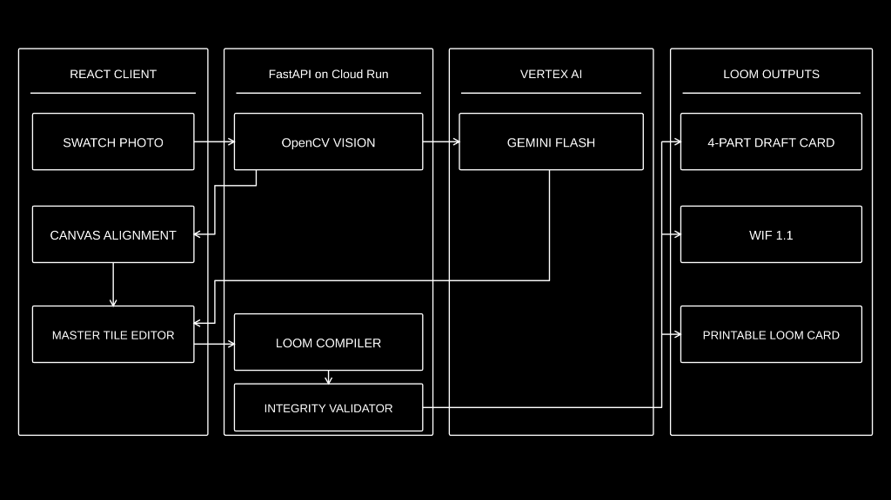
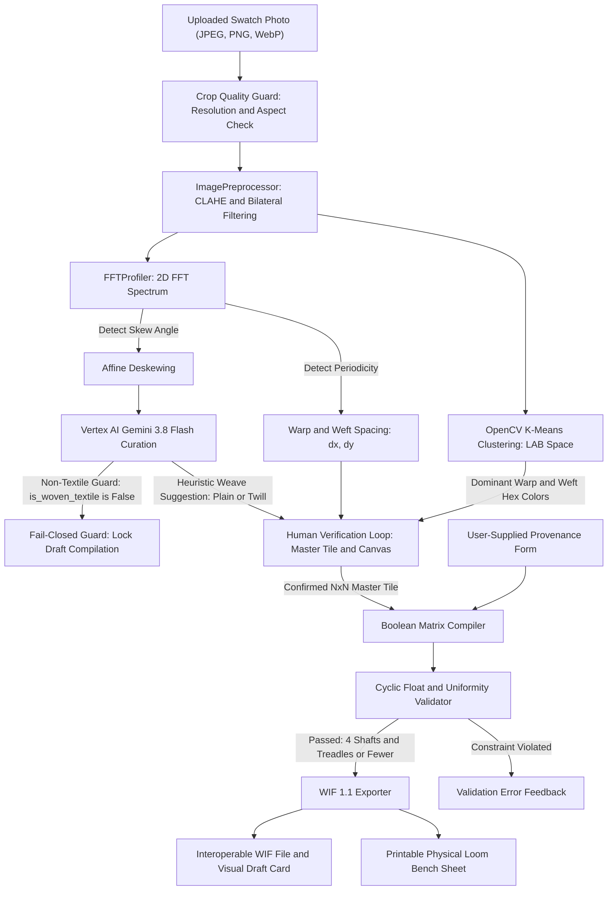

# ThreadLore: Deep Technical Architecture & Mathematical Specification

> **"Preserve the weave, not just the photograph."**  
> An AI-assisted, human-verified textile reconstruction pipeline that converts macro fabric photographs into mathematically validated, loom-compatible WIF 1.1 specifications.

---

## 1. System Philosophy & Design Invariants

Traditional textile digitization tools either treat weaving drafts as purely graphical illustrations or make brittle, speculative guesses on raw pixel crossings. ThreadLore takes a dual-engine approach:

1. **AI as an Uncalibrated Curation Assistant:** Gemini 3.8 Flash identifies likely weave structures (plain weave or straight twills) based on physical float characteristics and interlacing intervals. It **never certifies** the weave, and it **strictly prohibits speculating on cultural provenance, ethnic ancestry, or artisan identity**.
2. **Deterministic Mathematical Factorization:** Once the weaver verifies or adjusts the $N \times N$ master tile ($N \in \{2, 3, 4\}$), the deterministic compiler factors the repeat matrix into threading, tie-up, and treadling for physical 4-shaft rising-shed looms using closed-form Boolean matrix algebra.
3. **Phase Ambiguity Resolution:** 2D Fast Fourier Transform (FFT) measures thread periodicity ($\Delta x, \Delta y$) and orientation skew ($\theta$), but frequency analysis inherently discards spatial phase origin $(x_0, y_0)$. The interactive frontend canvas provides draggable $X/Y$ phase alignment so the weaver aligns the mathematical grid directly over photographed yarn crossings.



*High-resolution vector available at [assets/threadlore_architecture.svg](assets/threadlore_architecture.svg) and editable diagram source at [assets/ThreadLore_Architecture.excalidraw](assets/ThreadLore_Architecture.excalidraw).*



---

## 2. Computer Vision: 2D FFT Frequency Profiling

Textile macro swatches exhibit strong 2D spatial periodicity. Let $I(x, y)$ denote the windowed grayscale swatch:

$$\tilde{I}(x, y) = [I(x, y) - \mu_I] \cdot w_H(x, y)$$

where $w_H(x, y) = w_{\text{hanning}}(x) \otimes w_{\text{hanning}}(y)$ suppresses high-frequency boundary discontinuities.

### Frequency Analysis & Deskewing
1. **2D Fast Fourier Transform:**
   $$F(u, v) = \mathcal{F}\{\tilde{I}(x, y)\}, \quad M(u, v) = |F_{\text{shifted}}(u, v)|$$
2. **Dominant Orientation Angle ($\theta$):**  
   Principal energy concentrations reflect warp and weft directions. By folding radial spectral peaks into $[-45^\circ, 45^\circ]$ relative to orthogonal axes and performing radial line integration:
   $$\theta = \arg\max_{\alpha} \sum_{r} M(r \cos\alpha, r \sin\alpha) + M(-r \sin\alpha, r \cos\alpha)$$
3. **Orthogonal Thread Spacing ($\Delta x, \Delta y$):**  
   1D spectral profiles are integrated across the orthogonal center bands:
   $$\bar{P}_x(u) = \frac{1}{2B + 1} \sum_{v=-B}^{B} M(u, v), \quad \bar{P}_y(v) = \frac{1}{2B + 1} \sum_{u=-B}^{B} M(u, v)$$
   Using `scipy.signal.find_peaks` with prominence gating ($P_{\text{ratio}} \ge 3.0$):
   $$\Delta x = \frac{W}{u^*}, \quad \Delta y = \frac{H}{v^*}$$
4. **Never Invent Measurements:** If peak prominence fails confidence criteria (e.g. low contrast, fiber blur), the profiler returns `spacing_detected: false, dx_px: None, dy_px: None, status: 'uncertain'`. ThreadLore **never** invents synthetic numbers (such as 20.0px).

---

## 3. Vertex AI Gemini 3.8 Flash Technical Curation

ThreadLore integrates `google-genai==3.3.0` calling `gemini-3.8-flash` on Vertex AI (endpoint location configurable via `LOCATION=global` or `us-central1`, decoupled from Cloud Run compute).

### Prompt Invariants & Non-Speculation
- **Technical Scope:** Examines yarn float lengths, interlacing intervals, and diagonal wale direction (S vs Z).
- **Prohibition on Cultural Hallucination:** Explicitly prohibited from fabricating ethnic origin, artisan name, geographic provenance, or era. All cultural provenance is captured via user input in `ProvenanceMetadata`.
- **Uncalibrated Confidence Gate:** If heuristic confidence $< 0.60$ or the API call fails, the engine returns `status: "unavailable"` and prompts manual weaver selection.

---

## 4. Deterministic Boolean Matrix Loom Factorization

Given an $H \times W$ drawdown matrix $D \in \{0, 1\}^{H \times W}$ (where $D[i, j] = 1$ denotes warp over weft, and $0$ denotes weft over warp), a single-layer rising-shed loom requires factoring $D$ into:

1. **Threading Vector $T_h \in \{1, \dots, S\}^W$:** Shaft assigned to warp end $j$.
2. **Treadling Vector $T_r \in \{1, \dots, T\}^H$:** Treadle assigned to weft pick $i$.
3. **Tie-Up Matrix $M \in \{0, 1\}^{S \times T}$:** Shafts connected to treadles.

### Factorization Algorithm
1. **Shaft Assignment:** Extract distinct warp columns in $D$. Let $\{c_1, \dots, c_S\}$ be the unique columns ($S \le 4$). Assign $T_h[j] = s$ where column $j$ equals $c_s$. Choose a representative column index $j_s$ for each shaft:
   $$D[:, j_s] = c_s$$
2. **Treadle Assignment:** Extract distinct weft rows in $D$. Let $\{r_1, \dots, r_T\}$ be the unique rows ($T \le 4$). Assign $T_r[i] = t$ where row $i$ equals $r_t$. Choose a representative row index $i_t$ for each treadle:
   $$D[i_t, :] = r_t$$
3. **Closed-Form Tie-Up:** In a rising-shed, one-treadle-per-pick model, pressing treadle $t$ on pick $i_t$ raises exactly those shafts whose warp ends are lifted:
   $$M[s, t] = D[i_t, j_s]$$
4. **Exact Simulation Proof:**
   $$D_{\text{sim}}[i, j] = M[T_h[j] - 1, T_r[i] - 1] = D[i_{T_r[i]}, j_{T_h[j]}] = D[i, j]$$
   Every compiled draft simulates $D_{\text{sim}}$ and asserts $100\%$ identity with $D$.

---

## 5. Cyclic Float & Interlacing Validation

Fabric structural integrity requires continuous yarn interlacing:

1. **Uniform Thread Rejection:** If any weft row or warp column is all 0s or all 1s, the yarn floats completely across the fabric without interlacing. The validator rejects uniform threads immediately.
2. **Toroidal $2N$ Cyclic Float Tracking:** Fabric wraps continuously around repeats. Floats that span the repeat boundary are evaluated by doubling the sequence ($A \mathbin{\Vert} A$):
   $$\text{Float}_{\max} = \max_{1 \le k \le 2N} \left\{ \text{contiguous length of identical values in } A \mathbin{\Vert} A \right\}$$
   Floats exceeding $4$ threads are rejected for standard lightweight textiles.

---

## 6. Standards-Compliant WIF 1.1 Serialization

The Weaving Information File (WIF) specification (v1.1, October 1997) is the universal interchange format for digital looms. ThreadLore enforces:

- **Line Delimiters:** Windows CRLF (`\r\n`).
- **Mandatory `[WEAVING]` Section:**
  ```ini
  [WEAVING]
  Shafts=4
  Treadles=4
  Rising shed=1
  ```
- **Physical Measurement Units:** Must strictly be `Inches`, `Centimeters`, or `Decipoints`. Units such as `Pixels` are non-standard and rejected.
- **Numbered `[NOTES]` Lines:** WIF standard requires numbered line keys:
  ```ini
  [NOTES]
  1=Title: Harris Tweed Sample
  2=Origin: Outer Hebrides, Scotland
  3=Artisan/Maker: Traditional Croft Weaver
  4=Date/Period: c. 1920
  5=Conservation Notes: Museum archives sample
  6=Reconstructed via ThreadLore (Google Cloud Run)
  ```
- **1-Based Indexing:** Ends, picks, shafts, treadles, and palette colors strictly use 1-based keys (`1=`, `2=`, never `0=`).

---

## 7. OpenCV K-Means Dominant Yarn Color Extraction

Physical textiles consist of distinct warp and weft yarns with contrasting colors (e.g. indigo warp and ecru weft in denim; red, green, and black yarns in tartans). Rather than forcing weavers to manually search RGB values:

1. **Color Space Transform:** Input RGB swatch is transformed to CIE LAB color space, where Euclidean distance reflects human perceptual color difference ($\Delta E$).
2. **K-Means Clustering:** `cv2.kmeans` identifies the two most dominant color clusters ($K=2$, with $K=4$ fallback for multi-color tartans).
3. **Contrast Distance Verification:** The algorithm verifies perceptual contrast ($\Delta E \ge 12.0$) between the two cluster centers. If contrast is insufficient (e.g. solid piece-dyed fabrics), default high-contrast indigo and ecru palette values are returned as fallbacks.
4. **Hex Palette Seeding:** The resulting RGB centroids are serialized into `#RRGGBB` strings, auto-populating the UI warp and weft color pickers while remaining fully editable by the user.

---

## 8. Non-Textile Guard & Live Crop Resolution Quality Gates

To prevent garbage-in, garbage-out failure modes and preserve ethical AI guarantees:

1. **Live Crop Quality Guard:** The frontend `SwatchCropper` computes live aspect ratio and pixel dimensions. Swatches below $128 \times 128$ px display an amber advisory warning to prevent aliasing during 2D FFT frequency profiling. Crops below $100 \times 100$ px lock confirmation.
2. **Non-Textile Ingestion Guard:** When Gemini 3.8 Flash detects a non-woven object (wood, fruit, basketry, plain paper), it returns `is_woven_textile: false`. The Pydantic model validator automatically enforces `status: "unavailable"` and `confidence: 0.0`.
3. **Fail-Closed Compilation Lock:** If `is_woven_textile` is false, the "Compile 4-Shaft Loom Draft" button is hard-disabled, and a prominent banner presents options to adjust the crop or upload a macro fabric photograph.

